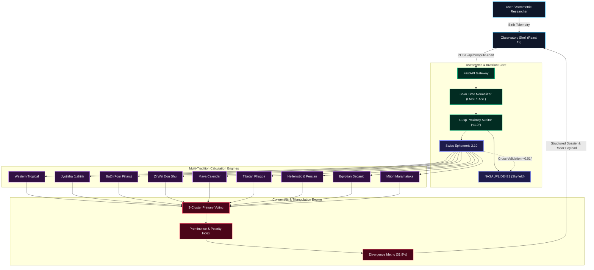

# Synodix: Astrometric Triangulation Engine & Observatory

[](LICENSE)
[](https://python.org)
[](https://fastapi.tiangolo.com)
[](https://react.dev)
[](https://www.astro.com/swisseph/)
[](https://rhodesmill.org/skyfield/)

**Synodix** is an enterprise-grade celestial mechanics and multi-tradition corroboration platform. It unifies high-precision modern astrometry (Swiss Ephemeris 2.10 and NASA JPL DE421) with nine distinct world astrological traditions, synthesizes their findings through a 3-cluster mathematical consensus matrix, and renders an observatory-class reactive interface with 10 interactive SVG wheels, radar matrices, and executive dossiers.

---

## 🧭 System Architecture & Vector Topology



---

## 🏛️ Standalone Interactive Archify Diagrams

All core architectural and dataflow models are maintained and compiled into standalone interactive HTML documents with animated trace motion:

| Diagram | Interactive HTML | Source Specification | Focus |
| :--- | :--- | :--- | :--- |
| **System Architecture** | 🔗 [architecture.html](docs/diagrams/architecture.html) | [architecture.json](docs/diagrams/architecture.json) | High-level system topology, boundaries, and clusters |
| **Calculation Workflow** | 🔗 [workflow.html](docs/diagrams/workflow.html) | [workflow.json](docs/diagrams/workflow.json) | 4-phase calculation path across all 9 tradition streams |
| **API Request Sequence** | 🔗 [sequence.html](docs/diagrams/sequence.html) | [sequence.json](docs/diagrams/sequence.json) | End-to-end telemetry ingestion, ephemeris parity, and synthesis |
| **Dataflow Pipeline** | 🔗 [dataflow.html](docs/diagrams/dataflow.html) | [dataflow.json](docs/diagrams/dataflow.json) | 5-stage transformation pipeline from raw epoch to observatory SVG |
| **Verification Lifecycle** | 🔗 [lifecycle.html](docs/diagrams/lifecycle.html) | [lifecycle.json](docs/diagrams/lifecycle.json) | State machine transitions, invariant gates, and cusp loops |

---

## 📚 Authoritative Project Documentation (`wiki/`)

Complete documentation is maintained in the [`wiki/`](wiki/) directory:

- 📖 **[Wiki Home](wiki/Home.md)**: Overview, mission, core principles, and quick links.
- 📐 **[System Architecture](wiki/Architecture.md)**: Layer responsibilities, security boundaries, and decoupled micro-engines.
- 🔭 **[Astrometric Dual-Engine](wiki/Astrometric-Dual-Engine.md)**: Swiss Ephemeris 2.10 vs NASA JPL DE421, solar time equations, cusp sensitivity audits.
- 🌐 **[Nine Traditions Engine](wiki/Nine-Traditions-Engine.md)**: In-depth mathematical formulas for Western, Vedic, BaZi, Zi Wei, Maya, Tibetan, Persian, Egyptian, and Māori traditions.
- 🗳️ **[Consensus Matrix](wiki/Consensus-Matrix.md)**: Cross-tradition triangulation mathematics, 9 Life Domains, 3-cluster voting, and divergence index ($\bar{d} \approx 31.8\%$).
- 📡 **[API Reference](wiki/API-Reference.md)**: REST endpoints (`POST /api/compute-chart`), request/response JSON schemas, and error codes.
- 🌊 **[Data Pipelines](wiki/Data-Pipelines.md)**: Ingestion, transformation, caching, and React 19 state synchronization.
- 🧬 **[State Lifecycle](wiki/State-Lifecycle.md)**: Verification state transitions, failure modes, and recovery paths.
- 🛠️ **[Runbooks & Operations](wiki/Runbooks.md)**: Developer quickstart, `./pipeline.sh` commands, Docker, testing, and release gates.

---

## 🌟 Key Features

### 1. Dual-Engine Astrometric Parity ($< 0.01^\circ$)
- Computes planetary positions via **Swiss Ephemeris 2.10** C-bindings.
- Cross-validates independently against **NASA JPL DE421** via Skyfield.
- Zero-tolerance boundary checks ($< 36\text{ arcsec}$) enforce astronomical veracity.

### 2. Nine Authentic World Astrological Traditions
- **Western Tropical**: Placidus houses, Ptolemaic aspects, minor aspects, antiscia/contra-antiscia, mutual reception.
- **Jyotisha (Vedic Sidereal)**: Lahiri ayanamsha, 27 Nakshatras & 108 Padas, Vimshottari Mahadashas, D1/D3/D7/D9/D10/D12 divisional charts, Gandanta zones, Graha Yuddha.
- **BaZi (Chinese Four Pillars)**: True Solar Time, 24 Solar Terms (Jie Qi), Day Master elemental strength, Ten Gods, Shen Sha symbolic stars, Four-Pillar Na Yin.
- **Zi Wei Dou Shu**: Chinese lunisolar calendar, 12 Palaces, Ming/Shen placement, 14 Major Stars, 10 Auxiliary Stars (6 auspicious, 4 malefic), Ming Star Quality index.
- **Maya Calendar Round**: Interlocking 260-day Tzolk'in count and 365-day Haab year, 13 Tonalities, 20 Solar Nawales, directional colors, Long Count round-trip verification.
- **Tibetan Phugpa**: 9 Mewa magic square, 8 Parkha trigrams (I Ching lineage), elemental dynamics (Mother, Son, Friend, Enemy).
- **Hellenistic & Persian**: The visible 7 planets, Diurnal/Nocturnal Sect, Almuten Figuris, Firdaria 75-year planetary periods, Lots of Fortune & Spirit.
- **Egyptian Decanic**: 36 Decans ($10^\circ$ segments), Sothic rising of Sopdet (Sirius), three seasonal cycles (Akhet, Peret, Shemu), epagomenal days.
- **Māori Maramataka**: 30-night oceanic lunar calendar, biological energy indicators for fishing, planting, harvesting, and communal reflection.

### 3. Cross-Tradition Triangulation & Consensus Matrix
- **3-Cluster Primary Voting**: Prevents lineage-correlated traditions from dominating consensus.
- **9 Life Domains**: Identity, Vitality, Emotion, Intellect, Relationships, Vocation, Prosperity, Transformation, Spirituality.
- **Honest Divergence Rate**: Disagreements between systems are quantified ($\bar{d} \approx 31.8\%$) and surfaced transparently as productive dialectics rather than smoothed over.

### 4. Culturally Authentic Display Presentation Theming & Instruments
- **9 Distinct Cultural Palettes & Lineage Banners**: Each tradition dynamically renders its authentic cultural color tokens, native scripts/calligraphy (e.g. Sanskrit, Traditional Chinese, Ancient Greek, Arabic, Egyptian Hieroglyphs, Māori), historical lineages, and cosmological mottos.
- **Universal Display Presentation Switcher**: Instantly toggle between `Comprehensive` (full instrument + data), `Visual Instrument` (focused astrolabe / dial presentation), and `Telemetry Tables` (granular data breakdown).
- **Culturally Framed Astronomical Visualizers**: 10 interactive SVG wheels and visual instruments framed in museum-grade, culture-accented borders and title bars (Parashari Diamond Kundali, Wu Xing Dynamic Pentagram, Ptolemaic 360° Wheel, Zi Wei Imperial Courtyard, Maya Stele Compass, Lo Shu Magic Square, Abu Ma'shar Almuten Bar Gauge, Ra's Cosmic Barque Star Clock, Oceanic 30-Night Lunar Dial).

---

## 🚀 Quickstart & Pipeline Execution

```bash
# 1. Clone repository
git clone https://github.com/manvenpratap/Synodix.git
cd Synodix

# 2. System check
./pipeline.sh doctor

# 3. Run regression tests (Minimal Tokens Protocol)
./pipeline.sh test --summary

# 4. Start backend daemon on all network interfaces for LAN mobile access (Terminal 1)
PYTHONPATH=. .venv/bin/python -m uvicorn backend.app.main:app --host 0.0.0.0 --port 8000 --reload

# 5. Start frontend dev server (Terminal 2)
npm run dev --prefix frontend -- --host 0.0.0.0 --port 5173

# 6. Native Mobile App Sync & Sideloading (iOS & Android)
npm run build --prefix frontend
cd frontend && npx cap sync

# Sideload Android:
# Install pre-compiled APK directly:
adb install Synodix-debug.apk

# Sideload iOS:
# Open project in Xcode, select Personal Team & connected iPhone, then press Run (Cmd+R):
npx cap open ios      # Opens frontend/ios/App/App.xcodeproj
npx cap open android  # Opens frontend/android in Android Studio
```

Visit the Observatory UI at `http://localhost:5173`, Swagger API Docs at `http://localhost:8000/docs`, or sideload directly onto physical iOS and Android devices (features 100% self-contained in-app calculation with zero server dependency).

---

## 📜 Invariant Commitments

- **Deterministic Precision**: All calculations are pure, functional, and reproducible.
- **Zero Console Errors**: Asserted continuously via Playwright regression test suite.
- **Radical Epistemological Humility**: Astrology is treated as a symbolic language and non-causal synchronicity framework; physical causality is neither claimed nor implied.

---
*Synodix • Maintained with Archify & Graphify Invariants • [GitHub Repository](https://github.com/manvenpratap/Synodix.git)*
