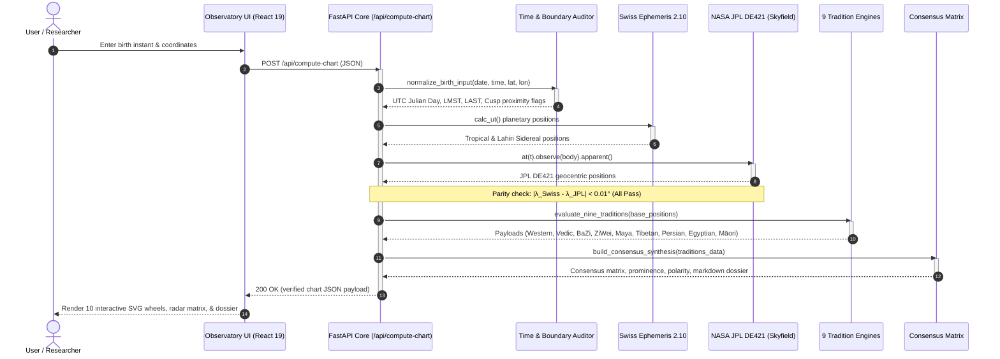

# REST API Reference

The Synodix backend is exposed via a high-performance, asynchronous FastAPI service adhering to OpenAPI 3.1 and REST standards. All computation endpoints run deterministically and complete in sub-second latency ($< 350\text{ms}$).

---

## ⏱️ Execution Sequence: API Request & Astrometric Triangulation



### Execution Sequence Details & Guarantees
1. **Request Intake (Steps 1–2)**: User enters birth datetime and coordinates in the React 19 UI. Payload is sent via HTTPS POST to `/api/compute-chart`.
2. **Astrometric Normalization (Steps 3–4)**: The Time & Boundary Auditor calculates Julian Day, LMST, LAST, and evaluates whether any planetary body sits within $1.0^\circ$ of a zodiacal or house boundary.
3. **Dual-Ephemeris Cross-Validation (Steps 5–9)**: Coordinates computed by Swiss Ephemeris 2.10 C-bindings are compared against NASA JPL DE421 numerical integrations. If disagreement exceeds $0.01^\circ$ (36 arcseconds), an invariant exception is raised.
4. **Autonomous Tradition Processing (Steps 10–11)**: All nine tradition modules evaluate their cultural logic independently without cross-contamination.
5. **Consensus Triangulation (Steps 12–13)**: The Consensus Matrix triangulates findings into a 3-cluster primary voting model and synthesizes the executive dossier.
6. **Reactive Client Render (Steps 14–15)**: The UI mounts 10 interactive SVG wheels, the 9-domain radar matrix, and executive markdown report without layout thrashing.

---

## 📡 Endpoints

### 1. `POST /api/compute-chart`
Calculates the complete multi-tradition astrometric chart, invariant audit, and consensus synthesis from birth telemetry.

#### Request Body Schema (`BirthInput`)
```json
{
  "year": 1990,
  "month": 7,
  "day": 15,
  "hour": 14,
  "minute": 30,
  "second": 0,
  "latitude": 28.6139,
  "longitude": 77.2090,
  "timezone": "Asia/Kolkata",
  "elevation_m": 216.0
}
```

#### Response Structure (`UnifiedChartResponse`)
* `meta`: Computation runtime, Julian day, LMST, and ephemeris source versions.
* `invariant_audit`: Dual-engine parity validation status and cusp proximity flags.
* `traditions`: Data dictionaries for all 9 systems (Western, Vedic, BaZi, Zi Wei, Maya, Tibetan, Persian, Egyptian, Māori).
* `consensus`: 3-cluster voting outcomes across 9 life domains, prominence scores, polarity indices, and divergence coefficient.
* `dossier_markdown`: Ready-to-render executive markdown document.

### 2. `GET /api/health`
Probes active system health, memory consumption, and verifies that Swiss Ephemeris and JPL DE421 ephemeris files are loaded in RAM.
