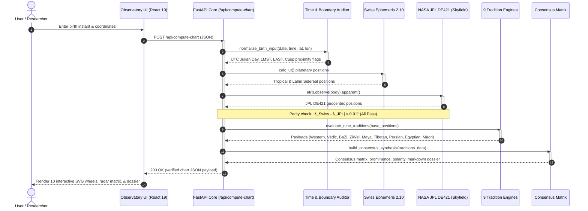

# REST API Reference

The Synodix backend is exposed via a high-performance, asynchronous FastAPI service adhering to OpenAPI 3.1 and REST standards. All computation endpoints run deterministically and complete in sub-second latency ($< 350\text{ms}$).

---

## ⏱️ Interactive Sequence Diagram & Spec
- 🔗 **[Explore Standalone Interactive Sequence Diagram (Archify HTML)](../docs/diagrams/sequence.html)**
- 📄 **[View Archify JSON Specification](../docs/diagrams/sequence.json)**

---

## 🔁 Vector API Request Sequence



---

## 📡 Endpoints

### 1. `POST /api/compute-chart`
Calculates the complete multi-tradition astrometric chart, invariant audit, and consensus synthesis from birth telemetry.

#### Request Body Schema (`BirthInput`)
```json
{
  "name": "Hypatia of Alexandria",
  "birth_date": "1990-06-21",
  "birth_time": "12:30",
  "time_certainty": "exact",
  "latitude": 31.2001,
  "longitude": 29.9187,
  "altitude_m": 10.0,
  "timezone_str": "Africa/Cairo"
}
```

| Field | Type | Required | Description | Constraints |
| :--- | :--- | :--- | :--- | :--- |
| `name` | `string` | Optional | Subject or chart identifier | Defaults to `"Subject"` |
| `birth_date` | `string` | **Yes** | Gregorian date string | Format: `YYYY-MM-DD` |
| `birth_time` | `string` | **Yes** | Local civil time string | Format: `HH:MM` (24-hour) |
| `time_certainty` | `string` | **Yes** | Precision confidence level | `["exact", "approximate", "unknown"]` |
| `latitude` | `float` | **Yes** | Decimal degrees North ($+$) / South ($-$) | $-90.0 \le \text{lat} \le 90.0$ |
| `longitude` | `float` | **Yes** | Decimal degrees East ($+$) / West ($-$) | $-180.0 \le \text{lon} \le 180.0$ |
| `altitude_m` | `float` | No | Observer height above sea level | Defaults to `0.0` meters |
| `timezone_str` | `string` | **Yes** | IANA Olson database identifier | E.g., `"America/New_York"`, `"Asia/Kolkata"` |

#### Response Schema (`ChartResponse`)
```json
{
  "subject_name": "Hypatia of Alexandria",
  "telemetry": {
    "utc_datetime": "1990-06-21T10:30:00Z",
    "julian_day_ut": 2448063.9375,
    "delta_t_sec": 57.2,
    "local_mean_sidereal_time": "06:23:41",
    "local_apparent_sidereal_time": "06:23:42",
    "equation_of_time_min": -1.82
  },
  "invariant_audit": {
    "status": "PASS",
    "max_ephemeris_delta_deg": 0.0028,
    "rahu_ketu_opposition_deg": 180.0,
    "cusp_sensitivity_flags": [
      {
        "body": "Mercury",
        "sign": "Cancer",
        "distance_to_cusp_deg": 0.42,
        "flag": "NEAR_SIGN_BORDER"
      }
    ]
  },
  "traditions": {
    "western": { /* Houses, aspects, dignities, antiscia */ },
    "jyotisha": { /* Nakshatra, D-charts, Dashas, Gandanta */ },
    "bazi": { /* Four Pillars, 10 Gods, Shen Sha, Na Yin */ },
    "ziwei": { /* 12 Palaces, 14 Stars, Ming Star Quality */ },
    "maya": { /* Tzolk'in, Haab, Calendar Round, Nawales */ },
    "tibetan": { /* Mewa 9, Parkha 8, Element Dyn */ },
    "persian": { /* Almuten Figuris, Firdaria, Sect, Lots */ },
    "egyptian": { /* 36 Decans, Sothic Rising, Season */ },
    "maramataka": { /* Lunar phase, Māori nights, Energy */ }
  },
  "consensus": {
    "domains": [
      {
        "id": "identity",
        "title": "Core Identity & Ego",
        "prominence": 0.88,
        "polarity": "Expansive",
        "consensus_tier": "HIGH_CONSENSUS",
        "participating_clusters": ["Cluster 1", "Cluster 2", "Cluster 3"]
      }
    ],
    "divergence_index": 0.312,
    "synthesis_reading_markdown": "# Astrometric Synthesis Dossier..."
  }
}
```

---

### 2. `GET /api/ephemeris-test`
Executes an immediate self-test of the dual-ephemeris engine, comparing SwissEph 2.10 and Skyfield JPL DE421 for the current UTC epoch.

#### Sample Response:
```json
{
  "status": "HEALTHY",
  "timestamp": "2026-10-21T06:30:00Z",
  "engines": {
    "swiss_ephemeris_version": "2.10.03",
    "skyfield_version": "1.49",
    "jpl_kernel": "de421.bsp"
  },
  "deltas": {
    "Sun": 0.00041,
    "Moon": 0.00215,
    "Mars": 0.00083,
    "Jupiter": 0.00012,
    "Saturn": 0.00034
  },
  "max_delta_deg": 0.00215,
  "threshold_deg": 0.01,
  "parity_pass": true
}
```

---

### 3. `GET /health`
System health check endpoint verifying uptime, database status, memory utilization, and background worker state.

---
*Next: [Data Pipelines](Data-Pipelines.md) • [State Lifecycle](State-Lifecycle.md)*
