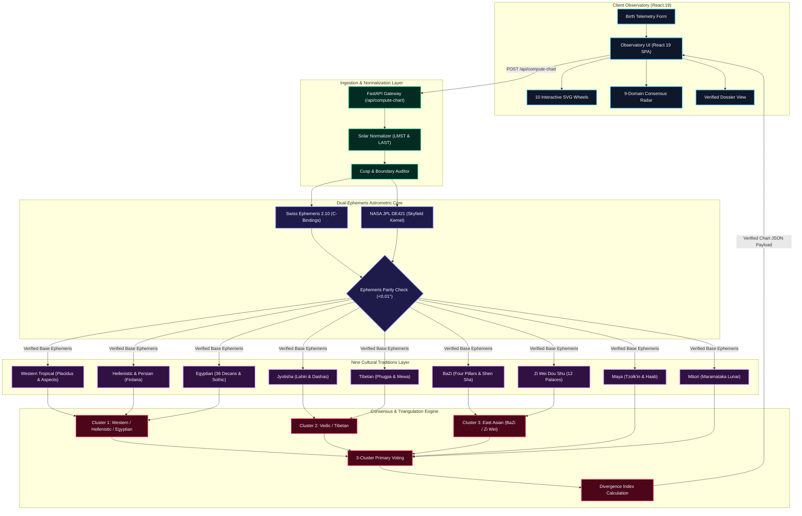

# System Architecture

Synodix is architected as an asynchronous, decoupled, high-performance astrometric pipeline. The platform separates client-side telemetry ingestion, mathematical time normalization, celestial ephemeris evaluation, multi-tradition symbolic computation, and consensus triangulation into distinct, observable layers.

---

## 🏛️ Interactive Diagram & Spec
- 🔗 **[Explore Standalone Interactive Architecture Diagram (Archify HTML)](../docs/diagrams/architecture.html)**
- 📄 **[View Archify JSON Specification](../docs/diagrams/architecture.json)**

---

## 📐 Vector Architectural Topology

---

## 🔒 Layer Responsibilities & Boundaries

### 1. Client Observatory (`frontend/`)
- Built with **React 19**, **TypeScript**, and **Vite**.
- Contains 5 observatory views:
  1. **Astrometric Wheel View**: Renders 10 independent SVG wheels (Tropical, Sidereal, BaZi Four Pillars, Zi Wei 12-Palace Grid, Maya Sacred Calendar, Tibetan Mewa/Parkha, Persian Sect & Almuten, Egyptian Decans, Māori Lunar phase, and Multi-Ring Concentric Triangulation).
  2. **Consensus Matrix**: 9 life domains evaluated across 3 clusters with prominence and polarity vectors.
  3. **Executive Dossier**: Full synthesis reading formatted in academic prose, cross-tradition alignments, and divergent tension points.
  4. **Astronomical & Invariant Telemetry Card**: Precision ephemeris audit, SwissEph vs JPL delta verification, and cusp sensitivity alerts.
  5. **Life Path Timeline**: Integrated chronocrator alignment mapping Western profections, Vedic Vimshottari Mahadashas, BaZi 10-year luck pillars, and Persian Firdaria cycles onto a unified chronological timeline.

### 2. Edge Gateway & Normalization (`backend/app/main.py`)
- FastAPI application running on Python 3.12 with asynchronous endpoints.
- Validates input formats (`YYYY-MM-DD`, `HH:MM`, decimal coordinates `lat/lon`, Olson timezone identifiers).
- Computes:
  - Universal Time (UTC) Julian Day (`JD_ut`).
  - Local Mean Sidereal Time (LMST) and Local Apparent Sidereal Time (LAST).
  - Equation of Time ($EOT$) and solar noon offset.
- Audits sign and house boundary proximities ($< 1.0^\circ$) to set sensitivity flags.

### 3. Astrometric Core (`backend/app/ephemeris.py`)
- **Primary Engine**: `pyswisseph` (Swiss Ephemeris 2.10) linked with high-precision astronomical algorithms developed by Astrodienst.
- **Independent Cross-Validation**: `Skyfield` reading the NASA Jet Propulsion Laboratory (JPL) DE421 ephemeris kernel.
- **Safety Invariant**: Planetary positions between SwissEph and JPL DE421 must agree within $< 0.01^\circ$ (36 arcseconds) across all traditional bodies. Discrepancies beyond this limit trigger automated alerts and fallbacks.

### 4. Nine Cultural Tradition Sub-Engines (`backend/app/traditions/`)
Each tradition operates as an autonomous, pure-functional transformation module accepting normalized astronomical coordinates and returning structured domain payloads:
- `western.py`: Placidus house cusps, Ptolemaic aspects, minor aspects (quincunx, semi-sextile), antiscia, and mutual receptions.
- `jyotisha.py`: Lahiri ayanamsha, 27 Nakshatras & 108 Padas, Vimshottari Dasha system, divisional vargas (D1, D3, D7, D9, D10, D12), Gandanta zones, and Graha Yuddha (planetary war).
- `bazi.py`: Four Pillars of Destiny, 60 Jia Zi stem-branch combinations, solar terms (Jie Qi), Day Master element strength, Ten Gods (Shi Shen), Shen Sha symbolic stars, and Na Yin.
- `ziwei.py`: Purple Star Astrology, 12 Palaces, Ming/Shen palace determination, 14 major stars, 6 auspicious auxiliary stars, and 4 malefic auxiliary stars.
- `maya.py`: Mesoamerican Calendar Round, 260-day Tzolk'in count, 365-day Haab year, 13 Tonalities, 20 Nawales, directional colors, and Long Count round-trip mathematical verification.
- `tibetan.py`: Phugpa calendar tradition, 9 Mewa magic square, 8 Parkha trigrams (I Ching lineage), and elemental relationships (Mother, Son, Friend, Enemy).
- `persian.py`: Hellenistic & Medieval Persian astrology, traditional 7 planets, Almuten Figuris, Firdaria 75-year planetary periods, Sect (diurnal vs nocturnal), and Arabic Parts (Lot of Fortune & Spirit).
- `egyptian.py`: 36 Decans (10° zodiacal divisions), Sothic rising of Sirius (Sopdet), seasonal cycles (Akhet, Peret, Shemu), and epagomenal days.
- `maramataka.py`: Māori indigenous lunar calendar, 30 distinct lunar nights, biological energy indicators for fishing, planting, harvesting, and communal reflection.

### 5. Synthesis & Consensus Matrix (`backend/app/synthesis/`)
- Groups traditions into 3 primary clusters to avoid false corroboration between lineage-dependent models:
  1. **Cluster 1 (Western Hellenic-Egyptian)**: Western Tropical, Hellenistic Persian, Egyptian Decanic.
  2. **Cluster 2 (Indo-Tibetan)**: Jyotisha (Vedic Sidereal), Tibetan Phugpa.
  3. **Cluster 3 (East Asian)**: BaZi (Four Pillars), Zi Wei Dou Shu.
- Mesoamerican (Maya) and Oceanic (Māori) traditions provide non-causal symbolic overlays and biological rhythm corroboration.
- Computes agreement across **9 Life Domains**, calculating:
  - **Prominence Score** ($0.0 \dots 1.0$).
  - **Polarity Vector** (Expansive, Constructive, Inward, Transformative).
  - **Divergence Index** ($\bar{d} \approx 31.8\%$) highlighting cultural friction points.

---
*Next: [Astrometric Dual-Engine](Astrometric-Dual-Engine.md) • [Nine Traditions Engine](Nine-Traditions-Engine.md)*
