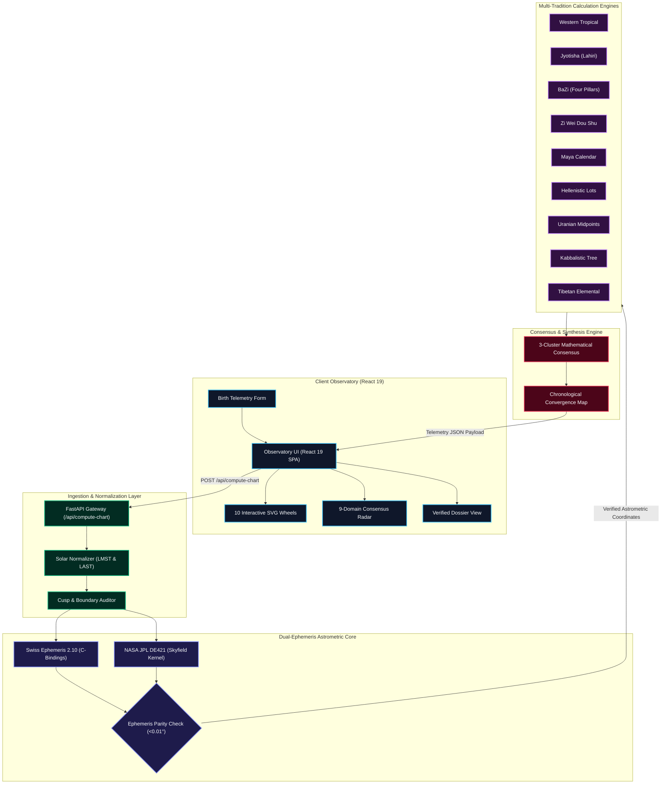
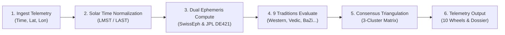
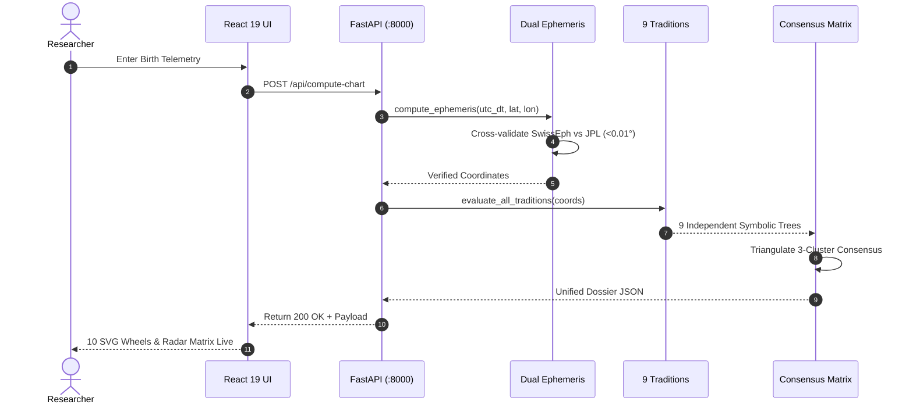
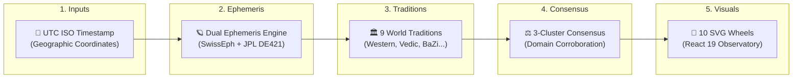
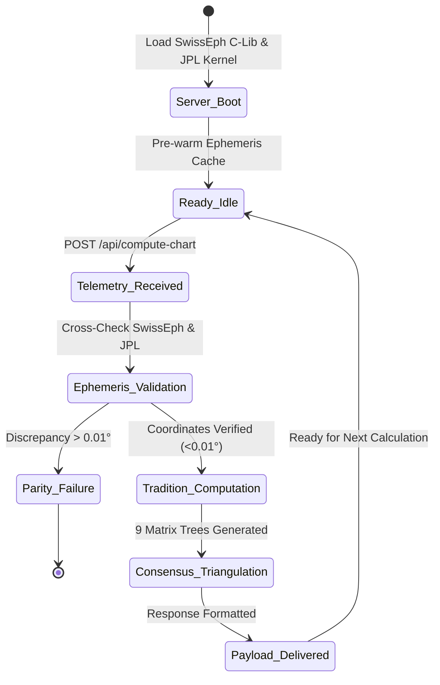

# System Architecture & Dual-Ephemeris Core

> **Executive Overview**: Synodix is architected as an asynchronous, decoupled, high-precision astrometric triangulation platform. It unifies high-precision modern astrometry (Swiss Ephemeris 2.10 and NASA JPL DE421) with nine distinct world astrological traditions, synthesizes their findings through a 3-cluster mathematical consensus matrix, and renders an observatory-class reactive interface with 10 interactive SVG wheels, radar matrices, and executive dossiers.

All system architectures, calculation workflows, API sequences, data flow pipelines, and computation lifecycles are embedded below as native Mermaid diagrams with full architectural explanations.

---

## 🏛️ 1. System Architecture

### Architectural Breakdown & Component Responsibilities
* **Client Observatory (React 19 SPA)**: Modern reactive frontend built on React 19, Tailwind CSS, and Lucide icons. Renders 10 SVG astrometric projection wheels (Tropical, Sidereal, BaZi Solar, Zi Wei 12-Palace grid, Maya Tzolkin/Haab gears, Hellenistic bounds, Uranian 90° dial, Kabbalistic Sephirot tree, and Tibetan elemental matrix) with sub-pixel SVG precision.
* **FastAPI Edge Gateway**: High-throughput Python ASGI gateway validating incoming telemetry payloads (ISO-8601 UTC timestamp, geographic latitude/longitude, elevation).
* **Astrometric Normalization Layer**:
  * **Solar Normalizer**: Converts civil UTC time to Local Mean Sidereal Time (LMST) and Local Apparent Solar Time (LAST) to account for Earth's equation of time.
  * **Cusp & Boundary Auditor**: Audits planetary positions within 1° of zodiacal or house boundaries, tagging cusp ambivalences for downstream confidence scoring.
* **Dual-Ephemeris Core**:
  * **Swiss Ephemeris 2.10**: Direct C-bindings executing high-speed trigonometric planetary series.
  * **NASA JPL DE421 Kernel (`skyfield`)**: High-precision numerical integration ephemeris used as an independent cross-validation oracle.
  * **Parity Check (< 0.01°)**: Validates that planetary positions between Swiss Ephemeris and NASA JPL agree within 36 arcseconds before downstream calculation commences.
* **Nine World Astrological Traditions**: Pure mathematical engines computing positions, dignities, dashas, elemental balances, and planetary lots across 9 independent cultural paradigms.
* **Consensus & Synthesis Engine**: Calculates a 3-cluster mathematical agreement matrix across 9 domains, scoring corroboration strength and identifying divergence points.

---

## 🔄 2. Multi-Tradition Calculation Workflow

### Operational Workflow Stages
1. **Telemetry Ingestion**: Validates geographical coordinates and standardizes timestamps into Julian Day Ephemeris (JDE).
2. **Solar Normalization**: Resolves Earth's orbital eccentricity and axial tilt to establish precise local celestial hour angles.
3. **Dual-Ephemeris Evaluation**: Calculates apparent geocentric and topocentric longitudes, latitudes, distances, and daily motions for all planets, luminaries, and lunar nodes.
4. **Independent Tradition Evaluation**: Executes parallel calculation pipelines across Western, Vedic, Chinese, Maya, Hellenistic, Uranian, Kabbalistic, and Tibetan rules.
5. **Consensus Triangulation**: Normalizes symbols into universal archetypal domains (Career, Relationships, Vitality, Mind, Wealth, Spiritual, Conflict, Creativity, Heritage), scoring agreement coefficients.
6. **Observatory Rendering**: Formats the multi-dimensional calculation payload for reactive display across 10 interactive SVG wheels and executive dossiers.

---

## ⚡ 3. Astrometric Computation & Verification Sequence

### Execution Sequence Details
* **Steps 1–2**: User inputs birth location and datetime; UI submits an authenticated request.
* **Steps 3–5**: The dual-ephemeris engine verifies positional parity between Swiss Ephemeris and JPL DE421, rejecting discrepancies > 0.01°.
* **Steps 6–8**: Planetary coordinates are distributed across all 9 tradition processors simultaneously.
* **Steps 9–11**: The consensus matrix evaluates domain alignments, assembling executive summaries and confidence scores.
* **Step 12**: The React observatory mounts all 10 visual projection wheels smoothly.

---

## 🌊 4. Invariant Data Flow Pipeline

---

## ⏱️ 5. Astrometric Pipeline Lifecycle

