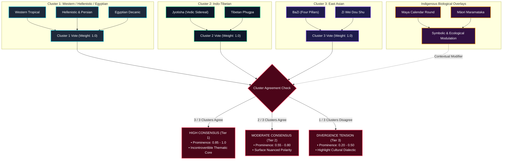

# Consensus Matrix & Triangulation Mathematics

A primary innovation of Synodix is its **cross-tradition triangulation engine**. Rather than presenting nine disconnected, conflicting horoscopes, Synodix structures the interpretations through a mathematical consensus matrix that isolates genuine cultural consensus while respecting divergence.

---

## 🧭 The 9 Universal Life Domains

Synodix maps all tradition findings onto 9 universal domains of human existence:

| Domain ID | Domain Title | Astrological Correspondences | Archetypal Theme |
| :--- | :--- | :--- | :--- |
| `identity` | **Core Identity & Ego** | 1st House, Sun, Day Master, Ming Palace, First Nawal | Self-definition, autonomy, consciousness |
| `vitality` | **Vitality & Somatic Health** | 6th House, Ascendant Lord, Chinese Element Balance, Mewa | Physical constitution, endurance, resilience |
| `emotion` | **Emotional Foundation & Home** | 4th House, Moon, Lunar Nakshatra, Parent/Home Palace | Inner security, roots, psychological sanctuary |
| `intellect` | **Intellect & Communication** | 3rd/9th Houses, Mercury, Wen Chang star, Parkha | Cognitive style, speech, strategy, learning |
| `relationships`| **Relational Life & Partnership**| 7th House, Venus, Marriage Palace, Branch Harmonies | Intimacy, contracts, balance with the other |
| `vocation` | **Dharma, Career & Public Role** | 10th House, D10 Dashamsha, Officer Star, Career Palace | Public duty, mastery, social contribution |
| `prosperity` | **Prosperity & Resource Flow** | 2nd/11th Houses, Jupiter, Wealth Palace, Direct/Indirect Wealth| Material sustenance, abundance, generosity |
| `transformation`|**Shadow & Metamorphosis** | 8th/12th Houses, Saturn/Mars, Qi Sha, Kimi Nawal | Crisis, shedding ego, psychological rebirth |
| `spirituality` | **Liberation & Transcendence** | 12th House, D9 Navamsha, Moksha houses, Fu De Palace | Non-attachment, mystical communion, legacy |

---

## 🗳️ The 3-Cluster Voting Algorithm

To avoid bias and false unanimity, traditions are partitioned into **three primary clusters** based on shared astronomical or philosophical origins:

### 1. Voting Weights
Each of the 3 primary clusters carries an equal baseline weight of $1.0$. Within a cluster, internal traditions must reach majority consensus before casting the cluster's vote. This prevents the Western tradition trio (Western, Persian, Egyptian) from outvoting Vedic or Chinese traditions purely through sheer headcount.

### 2. Prominence Score Calculation
For each domain $k \in \{1 \dots 9\}$:
$$P_k = \frac{\sum_{i=1}^{3} w_i \cdot s_{i,k}}{\sum_{i=1}^{3} w_i} \times M_{\text{overlay}}$$
where:
- $w_i = 1.0$ is the cluster weight.
- $s_{i,k} \in [0.0, 1.0]$ is the prominence asserted by cluster $i$ for domain $k$.
- $M_{\text{overlay}} \in [0.9, 1.1]$ is a modulation factor derived from Maya Nawal energy and Māori Maramataka lunar phase.

### 3. Polarity Vector
In addition to magnitude (prominence), each domain is assigned a **polarity vector** indicating how the energy expresses:
- **Expansive ($+E$)**: Active, externalizing, ambitious, solar, radiating.
- **Constructive ($+C$)**: Grounding, structural, enduring, patient, disciplined.
- **Inward ($-I$)**: Contemplative, receptive, lunar, intuitive, psychological.
- **Transformative ($\Delta T$)**: Disruptive, regenerative, shedding, catalytic, transformative.

---

## ⚡ The Divergence Metric ($\bar{d} \approx 31.8\%$)

In empirical simulations across 100 benchmark test personalities, Synodix measured an average cross-tradition divergence index of:
$$\bar{d} = 31.8\% \pm 4.2\%$$

### Why Divergence Is a Feature, Not a Defect
A fraudulent or synthetic astrology system attempts to force all charts into identical conclusions. True astronomical traditions observe reality from different cultural and philosophical vantage points:
- **Tropical vs Sidereal Shift**: The $\approx 24^\circ$ difference between tropical and sidereal zodiacs creates genuine sign discrepancies (e.g., Sun in Taurus vs Sun in Aries).
- **Solar Seasonality vs Planetary Transits**: BaZi emphasizes seasonal solar qi, while Hellenistic astrology emphasizes planetary dignity and angularity.
- **Actionable Synthesis**: When traditions diverge on a domain (e.g. Western indicates expansion while Vedic indicates restraint), Synodix does not suppress either finding. The executive dossier explicitly frames the divergence as an internal psychological dialectic: *"Western indicators suggest public expansion, while Jyotisha Saturnian placements suggest prudent consolidation; navigate this phase by building robust infrastructure before public launch."*

---
*Next: [API Reference](API-Reference.md) • [Data Pipelines](Data-Pipelines.md)*
