# Data Pipelines & Ingestion Flow

The Synodix data pipeline processes raw human birth telemetry into verified astrometric coordinates, multi-tradition symbolic matrices, and reactive visualization layers.

---

## 🌊 Interactive Dataflow Diagram & Spec

---

## 🔁 Vector Data Pipeline Flow

```mermaid
flowchart LR
    classDef stage0 fill:#0f172a,stroke:#38bdf8,stroke-width:2px,color:#f8fafc;
    classDef stage1 fill:#022c22,stroke:#10b981,stroke-width:2px,color:#f8fafc;
    classDef stage2 fill:#1e1b4b,stroke:#818cf8,stroke-width:2px,color:#f8fafc;
    classDef stage3 fill:#311042,stroke:#c084fc,stroke-width:2px,color:#f8fafc;
    classDef stage4 fill:#4c0519,stroke:#f43f5e,stroke-width:2px,color:#f8fafc;

    subgraph Stage_0 ["Stage 0: Sources"]
        Input["Birth Telemetry\n• Date, UTC, Coordinates"]:::stage0
        GeoDB["Geo & Ephemeris DB\n• Olson TZ & Delta-T"]:::stage0
    end

    subgraph Stage_1 ["Stage 1: Ingest & Audit"]
        SolarNorm["Solar Auditor\n• LMST, LAST, Eq of Time"]:::stage1
        CuspGuard["Cusp Boundary Guard\n• Orb & Sensitivity Check"]:::stage1
    end

    subgraph Stage_2 ["Stage 2: Astrometric Core"]
        SwissEph["SwissEph 2.10\n• calc_ut() high-precision"]:::stage2
        Skyfield["NASA JPL DE421\n• Skyfield cross-validator"]:::stage2
    end

    subgraph Stage_3 ["Stage 3: Tradition Synthesis"]
        Traditions["9 Tradition Engines\n• Western, Vedic, BaZi..."]:::stage3
        Consensus["Consensus Engine\n• 3-cluster voting & radar"]:::stage3
    end

    subgraph Stage_4 ["Stage 4: Observatory"]
        Dossier["Observatory Dossier\n• Executive synthesis doc"]:::stage4
        Wheels["Astrometric Wheels\n• 10 interactive SVG wheels"]:::stage4
    end

    Input -->|raw birth instant| SolarNorm
    GeoDB -->|offsets & timezones| CuspGuard
    SolarNorm -->|sidereal times| CuspGuard
    SolarNorm -->|UTC Julian date| SwissEph
    SwissEph -->|diff check <0.01°| Skyfield
    SwissEph -->|planetary positions| Traditions
    Traditions -->|tradition vectors| Consensus
    Skyfield -->|invariant parity PASS| Consensus
    Consensus -->|synthesis dossier| Dossier
    Consensus -->|polar coordinates| Wheels
```

---

## ⚙️ Stage-by-Stage Processing Protocol

### Stage 0: Telemetry Sources
1. **User Client Input**: The researcher supplies subject identifier, calendar date, civil clock time, latitude, longitude, and elevation.
2. **Geographical & Ephemeris Database**: Resolves Olson timezone boundaries, daylight savings rules, and historic $\Delta T$ tables.

### Stage 1: Ingestion & Boundary Audit
1. **Time Normalization**:
   - Converts local civil time to Universal Time ($UTC$).
   - Calculates Julian Day ($JD_{\text{ut}}$).
   - Computes Greenwich Mean Sidereal Time ($GMST$), Local Mean Sidereal Time ($LMST$), and Local Apparent Sidereal Time ($LAST$).
   - Solves the Equation of Time ($EOT$) to establish True Solar Time.
2. **Cusp & Boundary Audit**:
   - Checks every celestial body against sign boundaries ($30^\circ$ multiples) and house cusps.
   - Any separation $< 1.0^\circ$ generates a `NEAR_CUSP` alert and registers alternative sign probabilities.

### Stage 2: Dual Astrometric Evaluation
1. **Primary Evaluation (Swiss Ephemeris 2.10)**:
   - High-precision calculation of apparent geocentric planetary longitudes, latitudes, distances, and daily velocities ($d\lambda/dt$).
   - Calculates Placidus house cusps, Ascendant, Midheaven, Vertex, and Equatorial Ascendant.
   - Derives Lahiri sidereal longitudes via Chitra Paksha ayanamsha.
2. **Parity Cross-Validation (Skyfield / JPL DE421)**:
   - Queries the NASA JPL DE421 barycentric kernel for geocentric ecliptic coordinates of the Sun, Moon, and planets.
   - Enforces $|\lambda_{\text{SE}} - \lambda_{\text{JPL}}| < 0.01^\circ$. Discrepancies trigger validation warnings.

### Stage 3: Tradition Engines & Synthesis
1. **Independent Tradition Execution**:
   - 9 pure-functional tradition modules execute concurrently.
   - Each tradition produces its specific symbolic structures (e.g. Navamsha vargas, BaZi hidden stems, Zi Wei star qualities, Tzolk'in nawales).
2. **Consensus Engine**:
   - Groups results into the 3 primary cultural clusters.
   - Runs primary voting across 9 life domains.
   - Computes domain prominence, polarity vector, and cross-tradition divergence index ($\bar{d} \approx 31.8\%$).

### Stage 4: Reactive Observatory Consumption
1. **Observatory Dossier**:
   - Formatted Markdown report synthesizing consensus agreements, key archetypes, and cultural divergences.
2. **10 Interactive SVG Wheels**:
   - Renders vector celestial visualizers (Western Tropical, Vedic Sidereal, BaZi Four Pillars, Zi Wei Palaces, Maya Day Count, Tibetan Mewa, Persian Sect, Egyptian Decans, Māori Moon, and Multi-Ring Concentric Triangulation).
3. **Consensus Radar**:
   - 9-axis vector polygon charting life domain balance and cluster alignment.

---
*Next: [State Lifecycle](State-Lifecycle.md) • [Runbooks & Operations](Runbooks.md)*
