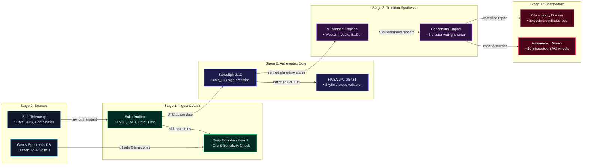

# Data Pipelines & Ingestion Flow

The Synodix data pipeline processes raw human birth telemetry into verified astrometric coordinates, multi-tradition symbolic matrices, and reactive visualization layers.

---

## 🌊 Invariant Data Flow Pipeline

---

## 🔄 Detailed Pipeline Stages

### Stage 0: Telemetry Ingest & Validation
- **Input Sanitization**: Parses birth coordinates (latitude $\in [-90, +90]$, longitude $\in [-180, +180]$) and checks ISO-8601 calendar validity.
- **Timezone Resolution**: Maps IANA Olson timezone strings to compute exact historical UTC offsets, accounting for wartime daylight saving time shifts.

### Stage 1: Solar & Boundary Normalization
- **Equation of Time**: Solves Earth's orbital eccentricity and obliquity to calculate Greenwich Mean Sidereal Time ($GMST$), Local Mean Sidereal Time ($LMST$), and Local Apparent Sidereal Time ($LAST$).
- **Cusp Proximity Auditor**: Scans planetary bodies against sign and house boundaries; bodies within $1.0^\circ$ are tagged with sensitive boundary alerts.

### Stage 2: Dual Astrometric Core
- **Swiss Ephemeris 2.10**: Computes geocentric and topocentric longitudes, latitudes, distances, and daily velocities ($d\lambda/dt$).
- **NASA JPL DE421 Parity Check**: Independent verification checking $|\lambda_{\text{SE}} - \lambda_{\text{JPL}}| < 0.01^\circ$.

### Stage 3: Multi-Tradition Evaluation & Consensus
- **9 Autonomous Engines**: Computes Western, Vedic, BaZi, Zi Wei, Maya, Tibetan, Persian, Egyptian, and Māori systems.
- **Consensus Triangulation**: 3-cluster voting identifies high-confidence convergent life themes and isolates cultural divergence metrics ($ar{d} pprox 31.8\%$).

### Stage 4: Reactive Observatory
- **10 SVG Wheels**: Interactive vector wheels render in React 19 with zoom, pan, and hover telemetry.
- **Executive Dossier**: Formatted markdown narrative summarizing convergent archetypes.
