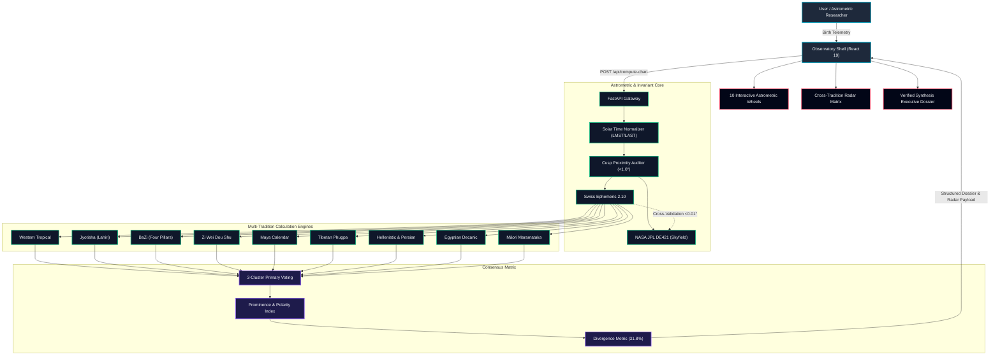

# Synodix • Astrometric Triangulation Engine Wiki

Welcome to the authoritative engineering and astrological documentation for **Synodix**, an enterprise-grade celestial mechanics and multi-tradition corroboration platform.

Synodix unifies high-precision modern astrometry (Swiss Ephemeris 2.10 and NASA JPL DE421) with nine distinct world astrological traditions, synthesizes their findings through a 3-cluster mathematical consensus matrix, and renders an observatory-class reactive interface with 10 interactive SVG wheels, radar matrices, and executive dossiers.

---

## 🧭 Wiki Catalogue & Navigation

| Document | Description | Key Focus |
| :--- | :--- | :--- |
| **[Architecture](Architecture.md)** | Full-stack system topology & architecture | Client, API Gateway, Dual-Engine Core, Synthesis |
| **[Astrometric Dual-Engine](Astrometric-Dual-Engine.md)** | High-precision ephemeris computation & time normalization | SwissEph 2.10, JPL DE421, LMST/LAST, Cusp Audit |
| **[Nine Traditions Engine](Nine-Traditions-Engine.md)** | Mathematical models for 9 astrological cultures | Western, Vedic, BaZi, Zi Wei, Maya, Tibetan, Persian, Egyptian, Māori |
| **[Consensus Matrix](Consensus-Matrix.md)** | Cross-tradition triangulation mathematics | 9 Life Domains, 3 Clusters, Prominence, Polarity, Divergence |
| **[API Reference](API-Reference.md)** | REST API endpoints, schemas, and sequence flow | `POST /api/compute-chart`, Invariant guarantees |
| **[Data Pipelines](Data-Pipelines.md)** | Ingestion, transformation, and distribution pipeline | Ingest $\rightarrow$ Audit $\rightarrow$ Core $\rightarrow$ Synthesis $\rightarrow$ UI |
| **[State Lifecycle](State-Lifecycle.md)** | Verification state transitions and failure modes | Telemetry $\rightarrow$ Ephemeris $\rightarrow$ Cusp Sweep $\rightarrow$ Verified |
| **[Runbooks & Operations](Runbooks.md)** | Developer quickstart, pipeline automation, deployment | `./pipeline.sh`, Docker, Testing, Release gates |

---

## 🏛️ Core Principles

1. **Astrometric Rigor**: No fuzzy approximations. All planetary and luminary coordinates are calculated using Swiss Ephemeris 2.10 down to arcseconds and cross-checked against NASA JPL DE421 kernel ephemerides.
2. **Cultural Fidelity**: Each tradition's internal logic is preserved authentically without westernizing or homogenizing formulas (e.g., BaZi true solar time, Maya Tzolk'in-Haab cycles, Vedic Lahiri ayanamsha, Tibetan Phugpa solar/lunar years).
3. **Mathematical Triangulation**: Traditions are grouped into three primary clusters to compute corroboration without false unanimity. Agreement amplifies signal; disagreement is surfaced transparently as an inherent divergence metric ($\bar{d} \approx 31.8\%$).
4. **Radical Epistemological Humility**: Synodix treats astrology as a structured symbolic language and non-causal synchronicity framework rather than literal physical gravitational determinism. Cusp proximities ($< 1.0^\circ$) trigger explicit sensitivity warnings.

---

## 🛠️ Technology Stack

```
Frontend:
├── React 19 (TypeScript) + Vite 6
├── Tailwind CSS + Custom Astrometric Design Tokens
├── Lucide React Icons
└── Capacitor 7 (Mobile iOS & Android wrapper)

Backend Core:
├── Python 3.12 + FastAPI + Uvicorn
├── pyswisseph (Swiss Ephemeris v2.10 C-bindings)
├── Skyfield + NASA JPL DE421 Ephemeris Kernel
├── NumPy & Pydantic v2
└── Pytest + Playwright E2E Test Suite
```

---

## 📊 Core Architecture Overview



---

## 📂 Archify Interactive Diagram Artifacts

All core architectural diagrams are maintained and compiled into standalone interactive HTML documents with animated trace motion:


---
*Synodix Documentation Suite • Maintained with Archify & Graphify Invariants*
