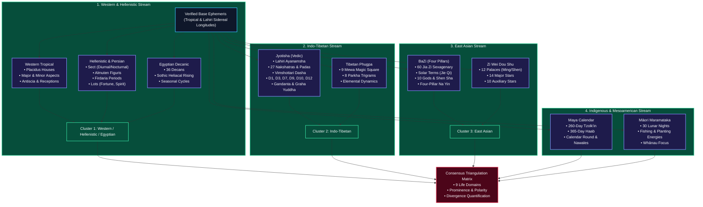

# Nine Traditions Engine

Synodix computes nine autonomous astrological systems from the normalized base ephemeris. Rather than forcing these traditions into a Western tropical mold, each engine calculates its positions according to its historic cultural and astronomical rules.

---

## 🔄 Interactive Workflow Diagram & Spec

---

## 🌐 Vector Processing Workflow

---

## 🏛️ Comprehensive Breakdown of the 9 Traditions

### 1. Western Tropical Astrology (`western.py`)
- **Coordinate System**: Tropical Zodiac (fixed to the vernal equinox at $0^\circ$ Aries).
- **House System**: Placidus semi-arc method.
- **Major Ptolemaic Aspects**: Conjunction ($0^\circ$), Sextile ($60^\circ$), Square ($90^\circ$), Trine ($120^\circ$), Opposition ($180^\circ$).
- **Minor Aspects**: Semi-sextile ($30^\circ$, orb $2^\circ$), Quincunx / Inconjunct ($150^\circ$, orb $3^\circ$), Semi-square ($45^\circ$, orb $2^\circ$), Sesquiquadrate ($135^\circ$, orb $2^\circ$).
- **Applying vs Separating**: Calculated dynamically from instantaneous planetary speeds ($d\lambda/dt$) — closing angular distance indicates applying; widening distance indicates separating.
- **Antiscia & Contra-Antiscia**: Solstice reflections computed across the $0^\circ\text{ Cancer} / 0^\circ\text{ Capricorn}$ axis ($\lambda_{\text{antiscia}} = (180^\circ - \lambda) \pmod{360^\circ}$) and equinox reflections across the $0^\circ\text{ Aries} / 0^\circ\text{ Libra}$ axis ($\lambda_{\text{contra}} = (360^\circ - \lambda) \pmod{360^\circ}$).
- **Mutual Reception**: Identified when two planets each reside in the other's domicile (e.g. Mars in Taurus and Venus in Aries).

### 2. Jyotisha / Vedic Sidereal Astrology (`jyotisha.py`)
- **Coordinate System**: Sidereal Zodiac with standard **Lahiri (Chitra Paksha) Ayanamsha**:
  $$\lambda_{\text{sidereal}} = \lambda_{\text{tropical}} - \text{Ayanamsha}$$
- **27 Nakshatras & 108 Padas**: Each nakshatra spans $13^\circ 20'$ ($800'$), divided into 4 padas of $3^\circ 20'$ ($200'$). Moon's pada determines the birth syllable and starting Vimshottari Mahadasha balance.
- **Vimshottari Dasha System**: 120-year cycle apportioned to Ketu (7y), Venus (20y), Sun (6y), Moon (10y), Mars (7y), Rahu (18y), Jupiter (16y), Saturn (19y), Mercury (17y).
- **Divisional Charts (Vargas)**:
  - **D1 Rashi**: Physical incarnation and general life structure.
  - **D3 Drekkana**: Siblings, courage, vitality ($10^\circ$ segments).
  - **D7 Saptamsha**: Children, creative legacy ($4^\circ 17' 8.57''$ segments).
  - **D9 Navamsha**: Soul purpose, marriage, inner dharma ($3^\circ 20'$ segments).
  - **D10 Dashamsha**: Career, reputation, public leadership ($3^\circ$ segments).
  - **D12 Dwadashamsha**: Lineage, ancestral karma ($2^\circ 30'$ segments).
- **Gandanta Detection**: Critical transitional zones between water and fire signs at the nakshatra boundary (Revati/Ashwini at $0^\circ$ Aries, Ashlesha/Magha at $0^\circ$ Leo, Jyeshtha/Mula at $0^\circ$ Sagittarius) within $3^\circ 20'$ orb.
- **Graha Yuddha (Planetary War)**: Evaluates non-luminary planets within $1^\circ$ longitude; the planet with higher celestial latitude wins the war.
- **Classical Yogas**: Pancha Mahapurusha yogas, Gajakesari, Neecha Bhanga Raja Yoga, Dhana yogas, Chandra-Mangal, and Amala yoga.

### 3. BaZi / Chinese Four Pillars of Destiny (`bazi.py`)
- **Temporal Base**: True Solar Time and 24 Solar Terms (Jie Qi). Year boundary begins at Lichun (Beginning of Spring, $\approx$ Feb 4), and month pillars begin at solar terms, not the Gregorian calendar.
- **Four Pillars**: Year, Month, Day, and Hour Pillars, each composed of a Heavenly Stem (Tian Gan) and an Earthly Branch (Di Zhi).
- **Day Master (Ri Yuan)**: The Heavenly Stem of the Day Pillar represents the core self. Its elemental strength (Strong, Balanced, Weak) is evaluated against the Month Branch (season).
- **Ten Gods (Shi Shen)**: Relational classification of all stems relative to the Day Master: Companion (Bi Jian), Rob Wealth (Jie Cai), Eating God (Shi Shen), Hurting Officer (Shang Guan), Direct Wealth (Zheng Cai), Indirect Wealth (Pian Cai), Direct Officer (Zheng Guan), 7 Killings (Qi Sha), Direct Resource (Zheng Yin), Indirect Resource (Pian Yin).
- **Branch Interactions**:
  - Six Clashes (Liu Chong): Zi-Wu, Chou-Wei, Yin-Shen, Mao-You, Chen-Xu, Si-Hai.
  - Six Harmonies (Liu He) & Three Harmonies (San He).
  - Three Punishments (San Xing) & Six Harms (Liu Hai).
- **Shen Sha (Symbolic Stars)**: Tian Yi Gui Ren (Noble Star), Tao Hua (Peach Blossom), Yi Ma (Travelling Horse), Hua Gai (Canopy Star), and Yang Ren (Blade).
- **Four-Pillar Na Yin**: 60-cycle melodic elements computed for Year, Month, Day, and Hour pillars.

### 4. Zi Wei Dou Shu / Purple Star Astrology (`ziwei.py`)
- **Lunar Calendar Base**: Synchronized with the traditional Chinese lunisolar calendar.
- **12 Palaces**: Life (Ming), Siblings, Marriage, Children, Wealth, Health, Travel, Friends, Career, Property, Pleasure (Fu De), and Parents.
- **Ming & Shen Palace Placement**: Computed from the lunar birth month and birth double-hour (Shi Chen).
- **Five Elements Bureau (Wu Xing Ju)**: Water 2, Wood 3, Gold 4, Earth 5, Fire 6, derived from the Ming Palace stem and branch.
- **14 Major Stars**:
  - *Northern Dipper*: Zi Wei (Emperor), Tian Ji, Tai Yang, Wu Qu, Tian Tong, Lian Zhen.
  - *Southern Dipper*: Tian Fu, Tai Yin, Tan Lang, Ju Men, Tian Xiang, Tian Liang, Qi Sha, Po Jun.
- **Auxiliary Stars**:
  - *Six Auspicious Stars*: Wen Chang, Wen Qu, Zuo Fu, You Bi, Tian Kui, Tian Yue.
  - *Four Malefic Stars*: Huo Xing, Ling Xing, Qing Yang, Tuo Luo.
- **Ming Star Quality**: Quantitative index scoring the concentration of auspicious vs challenging stars in the Life Palace.

### 5. Maya Calendar / Mesoamerican Count (`maya.py`)
- **Tzolk'in (Sacred Almanac)**: 260-day cycle generated by interlocking 13 Tonalities (numbers $1 \dots 13$) with 20 Solar Nawales (Imix, Ik', Ak'b'al, K'an, Chikchan, Kimi, Manik', Lamat, Muluk, Ok, Chuwen, Eb', B'en, Ix, Men, Kib', Kab'an, Etz'nab', Kawak, Ajaw).
- **Haab' (Solar Civil Year)**: 365-day year composed of 18 named months of 20 days (Pop, Wo, Sip, Sotz', Sek, Xul, Yaxk'in, Mol, Ch'en, Yax, Sak', Keh, Mak, K'ank'in, Muwan, Pax, K'ayab', Kumk'u) followed by the 5-day transitional Wayeb' period.
- **Calendar Round**: Interlocking 52-year (18,980-day) period where a specific Tzolk'in day and Haab' day coincide.
- **Correlation**: Standard GMT (Goodman-Martínez-Thompson) correlation constant ($584,283$).
- **Round-Trip Mathematical Invariant**: Every computed Tzolk'in and Haab' date is mathematically validated against Gregorian Julian Day conversions.

### 6. Tibetan Phugpa Astrology (`tibetan.py`)
- **Calendar Tradition**: The Phugpa lineage established by Phugpa Lhundrub Gyatso in the 15th century.
- **9 Mewa (Magic Square / Lo Shu)**: 9 cosmic numbers associated with colors, elements, directions, and past-life karmic imprints.
- **8 Parkha (Trigrams)**: Trigrams of the I Ching tradition adapted into Tibetan geomancy: Li (Fire), Khon (Earth), Dwa (Iron), Khen (Sky), Kham (Water), Gin (Mountain), Zin (Tree), Zon (Wind).
- **Elemental Dynamics**: Five elements (Wood, Fire, Earth, Metal, Water) evaluated across four primary relationships:
  - Mother (Nurturing / Generating)
  - Son (Depleting / Offspring)
  - Friend (Harmonious / Wealth)
  - Enemy (Overcoming / Controlling)

### 7. Hellenistic & Medieval Persian Astrology (`persian.py`)
- **The Traditional Septenary**: Restricted strictly to the visible 7 planets (Sun, Moon, Mercury, Venus, Mars, Jupiter, Saturn) in accordance with ancient Hellenistic and Arab-Persian methodology.
- **Sect (Hairesis)**: Diurnal vs Nocturnal chart classification based on whether the Sun is above or below the horizon ($C_1 - C_7$ axis). Determines planetary team strengths:
  - *Day Sect*: Sun (luminary), Jupiter (benefic), Saturn (malefic).
  - *Night Sect*: Moon (luminary), Venus (benefic), Mars (malefic).
- **Almuten Figuris**: The overall chart ruler computed by summing dignity points (domicile 5, exaltation 4, triplicity 3, term 2, face 1) across the 5 Hylegical points (Sun, Moon, Ascendant, Part of Fortune, Syzygy).
- **Firdaria (Al-Firdar)**: 75-year planetary period rulership system (78 years for nocturnal births with North/South nodes), dividing life into major and minor planetary chapters.
- **Hermetic Lots**:
  - Lot of Fortune: $\text{Asc} + \text{Moon} - \text{Sun}$ (day) or $\text{Asc} + \text{Sun} - \text{Moon}$ (night).
  - Lot of Spirit: $\text{Asc} + \text{Sun} - \text{Moon}$ (day) or $\text{Asc} + \text{Moon} - \text{Sun}$ (night).

### 8. Ancient Egyptian Decanic Astrology (`egyptian.py`)
- **36 Decans**: Each of the 12 zodiac signs is divided into three $10^\circ$ segments, each presided over by an ancient Egyptian stellar deity (Bakst, Kenmu, Charchnumis, etc.).
- **Sothic Heliacal Rising**: The annual dawn rising of Sopdet (Sirius), historically coinciding with the Nile inundation and the Egyptian civil new year.
- **Three Seasons**:
  - *Akhet* (Inundation): Flooding and renewal.
  - *Peret* (Emergence / Growth): Planting and agricultural work.
  - *Shemu* (Low Water / Harvest): Gathering and accounting.
- **Epagomenal Days**: The 5 intercalary days (Mesut Necheru) added at year's end celebrating the births of Osiris, Horus the Elder, Set, Isis, and Nephthys.

### 9. Māori Indigenous Lunar Calendar (`maramataka.py`)
- **30 Lunar Nights**: Tracking the Moon's phase from Whiro (New Moon) through Mutuwhenua (Dark Moon) using ancient Māori navigational and ecological knowledge.
- **Biological Rhythms & Energy Phases**:
  - High energy planting & ocean fishing nights (Oike, Okoro, Tamatea, Oturu).
  - Reflective, low energy, inland nights (Whiro, Mutuwhenua, Mauri).
- **Whānau & Karakia Advisories**: Practical life recommendations rooted in traditional Polynesian celestial ecological awareness.

---
*Next: [Consensus Matrix](Consensus-Matrix.md) • [API Reference](API-Reference.md)*
