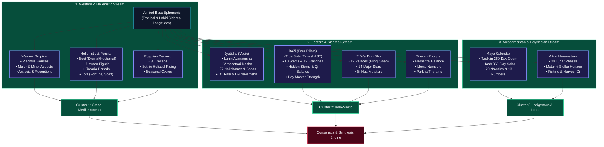

# Nine Traditions Engine

Synodix computes nine autonomous astrological systems from the normalized base ephemeris. Rather than forcing these traditions into a Western tropical mold, each engine calculates its positions according to its historic cultural and astronomical rules.

---

## 🔄 Multi-Tradition Calculation Workflow

### Architectural Breakdown of Traditions
1. **Western Tropical**: Equinox-anchored ecliptic zodiac ($0^\circ \Upsilon$), Placidus house quadrant division, Ptolemaic aspects, and antiscia reflections.
2. **Hellenistic & Persian**: Planetary sect governance (diurnal vs. nocturnal conditions), Almuten calculations, planetary lots (Lot of Fortune, Lot of Spirit), and Firdaria planetary period cycles.
3. **Egyptian Decanic**: 36 ten-degree decans, Egyptian faces, and heliacal rising sequences.
4. **Vedic (Jyotisha)**: Fixed-star Chitra Paksha (Lahiri) ayanamsha, 27 Nakshatras divided into 108 Padas, Vimshottari 120-year dasha periods, D1 Rasi root chart, and D9 Navamsha harmonic chart.
5. **Chinese BaZi (Four Pillars)**: Year, Month, Day, and Hour pillars calculated with Local Apparent Solar Time (LAST). Ten Heavenly Stems, Twelve Earthly Branches, hidden stem interactions, and five-phase Wu Xing balance.
6. **Chinese Zi Wei Dou Shu (Purple Star)**: Twelve life palaces (Ming, Wealth, Career, Siblings, etc.), fourteen major stars, and Si Hua annual transformations.
7. **Tibetan Phugpa**: Synthesizes Indian Kalachakra with Chinese elemental calculations, computing 9 Mewa birth numbers and 8 Parkha trigrams.
8. **Maya Calendar**: Continuous Long Count progression correlating Tzolk'in (260-day sacred almanac) with Haab (365-day solar calendar) to identify the governing Nawal and Trecena energy.
9. **Māori Maramataka**: Thirty distinct lunar night phases tracking vitality, community action, and the seasonal heliacal rising of Matariki (Pleiades).

---

## 🎨 Cultural Theming & Visual Display Presentations

Each tradition in the Observatory renders within a culturally authentic visual design theme, respecting historical cosmology, native script typography, and museum-grade visual instrument framing:

| Tradition | Cultural Palette | Native Title & Script | Cosmological Motto | Visual Instrument |
| :--- | :--- | :--- | :--- | :--- |
| **Jyotisha** | Sacred Saffron & Vedic Brass | `ज्योतिष • Vedic Astrometry` | *यथा पिण्डे तथा ब्रह्माण्डे* (As is the microcosm, so is the macrocosm) | Parashari Diamond Kundali |
| **BaZi** | Imperial Cinnabar & Jade | `八字命理 • Four Pillars of Destiny` | *天地陰陽，五行生剋* (Heaven and Earth in Yin-Yang and Wu Xing harmony) | Wu Xing Dynamic Elemental Pentagram |
| **Western** | Aegean Lapis & Grecian Bronze | `Ἑλληνιστικὴ Ἀστρολογία • Hellenistic` | *Sicut superius, sic inferius* (As above, so below) | Ptolemaic 360° Circular Aspect Wheel |
| **Persian** | Isfahan Turquoise & Damascene Gold | `علم النجوم • ‘Ilm al-Nujūm` | The Supreme Almuten guides the celestial soul through weighted dignity | Almuten Figuris Dignity Bar Gauge |
| **Egyptian** | Pharaonic Sun Gold & Nile Basalt | `𓇹𓇳𓏤 • Seba’ut & Bakhtiu Watchers` | Ra navigates through the 36 hourly Decanic Star Gates of Heaven | Dendera 36-Decan Star Compass Clock |
| **Zi Wei** | Forbidden City Imperial Plum & Amethyst | `紫微斗數 • Imperial Constellations` | *紫微至尊，儀錄百神* (The Polar Emperor presides over the Twelve Palaces) | Authentic 4x4 Imperial Courtyard Grid |
| **Maya** | Mesoamerican Jadeite & Obsidian | `Chol Q’ij & Haab’ • Maya Sacred Calendar` | The 260-day Tzolk'in and 365-day Haab' mesh into the 52-year Calendar Round | Tzolk'in & Haab' Stele Gear Dial |
| **Tibetan** | Himalayan Yak Maroon & Saffron Robe | `དཀར་རྩིས་ • Kar-tsi & Jung-tsi` | Sog, Lu, Wang, Lungta, and La flowing through the 9 Mewa and 8 Parkha | 3x3 Lo Shu Mewa Magic Square |
| **Maramataka** | Pacific Deep Indigo & Pounamu Green | `Te Maramataka • Oceanic Lunar Wayfinding` | *Nā te pō i hua mai te ao* (From the night came forth the world) | 30-Phase Oceanic Lunar Dial |

### Universal Display Presentation Modes
Every tradition features a dedicated 3-way presentation switcher:
1. **Comprehensive**: Simultaneous presentation of the cultural visual instrument alongside deep mathematical telemetry tables.
2. **Visual Instrument**: High-focus view centered on the culture's vector astrolabe, compass, or mandala.
3. **Telemetry Tables**: High-density tabular layout for comparative astrometric analysis and ephemeris inspection.
