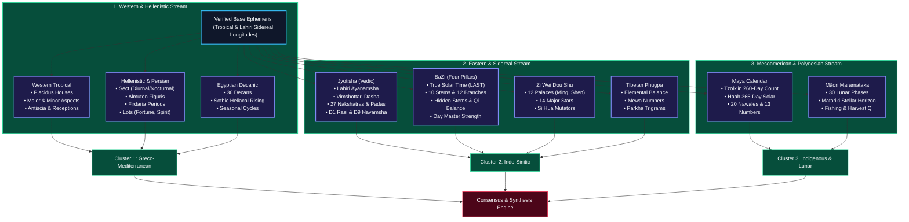

# Nine Traditions Engine

Synodix computes nine autonomous astrological systems from the normalized base ephemeris. Rather than forcing these traditions into a Western tropical mold, each engine calculates its positions according to its historic cultural and astronomical rules.

---

## 🔄 Multi-Tradition Calculation Workflow

### Architectural Breakdown of Traditions
1. **Western Tropical**: Equinox-anchored ecliptic zodiac ($0^\circ \Upsilon$), Placidus house quadrant division, Ptolemaic aspects, and antiscia reflections.
2. **Hellenistic & Persian**: Planetary sect governance (diurnal vs. nocturnal conditions), Almuten calculations, planetary lots (Lot of Fortune, Lot of Spirit), and Firdaria planetary period cycles.
3. **Egyptian Decanic**: 36 ten-degree decans, Egyptian faces, and heliacal rising sequences.
4. **Vedic (Jyotisha)**: Fixed-star Chitra Paksha (Lahiri) ayanamsha, 27 Nakshatras divided into 108 Padas, Vimshottari 120-year dasha periods, D1 Rasi root chart, and D9 Navamsha harmonic chart.
5. **Chinese BaZi (Four Pillars)**: Year, Month, Day, and Hour pillars calculated with Local Apparent Solar Time (LAST). Ten Heavenly Stems, Twelve Earthly Branches, hidden stem interactions, and five-phase Wu Xing balance.
6. **Chinese Zi Wei Dou Shu (Purple Star)**: Twelve life palaces (Ming, Wealth, Career, Siblings, etc.), fourteen major stars, and Si Hua annual transformations.
7. **Tibetan Phugpa**: Synthesizes Indian Kalachakra with Chinese elemental calculations, computing 9 Mewa birth numbers and 8 Parkha trigrams.
8. **Maya Calendar**: Continuous Long Count progression correlating Tzolk'in (260-day sacred almanac) with Haab (365-day solar calendar) to identify the governing Nawal and Trecena energy.
9. **Māori Maramataka**: Thirty distinct lunar night phases tracking vitality, community action, and the seasonal heliacal rising of Matariki (Pleiades).
