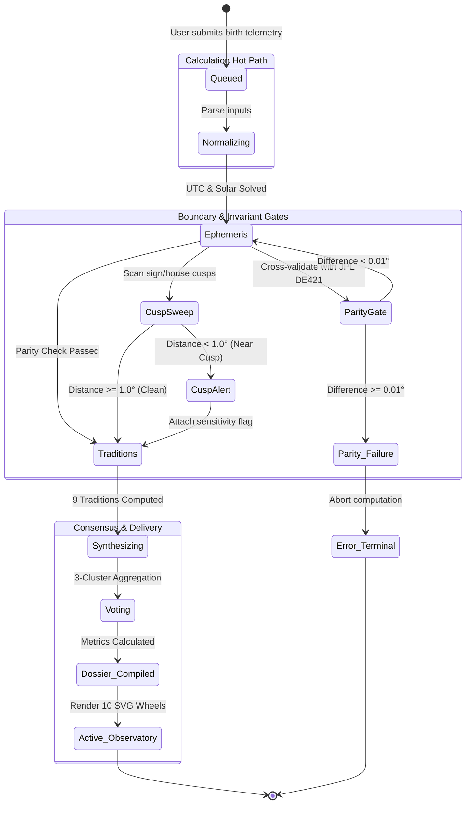

# State Lifecycle & Verification Machine

The Synodix calculation lifecycle is modeled as a deterministic state machine that guides each chart request from initial telemetry ingest through invariant verification, sensitivity checks, and terminal observatory states.

---

## ⏱️ Astrometric Calculation & Invariant State Lifecycle

### Lifecycle State Machine Transitions
* **`Queued`**: Receives raw request payload; validates geographical bounds and calendar integrity.
* **`Normalizing`**: Resolves local daylight saving anomalies, converts to UTC, and calculates sidereal hour angles.
* **`ParityGate`**: Cross-validates Swiss Ephemeris against NASA JPL DE421 numerical coordinates. Discrepancies $\ge 0.01^\circ$ trigger `Parity_Failure`.
* **`CuspSweep`**: Evaluates cusp proximity. When bodies are within $1.0^\circ$ of a boundary, `CuspAlert` attaches sensitivity tags to prevent overconfident interpretations.
* **`Traditions`**: Concurrently evaluates the nine independent tradition models.
* **`Voting & Dossier_Compiled`**: Triangulates cross-tradition domain scores and compiles the markdown executive dossier.
* **`Active_Observatory`**: Terminal successful state where all 10 interactive SVG wheels render in the client browser.
