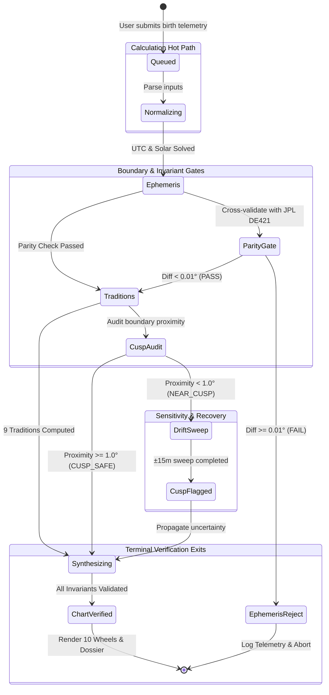

# State Lifecycle & Verification Machine

The Synodix calculation lifecycle is modeled as a deterministic state machine that guides each chart request from initial telemetry ingest through invariant verification, sensitivity checks, and terminal observatory states.

---

## 🧬 Interactive Lifecycle Diagram & Spec

---

## 🔁 Vector State Diagram

---

## 📋 State Definitions & Transition Criteria

### 1. Hot Path States
| State ID | Type | Step | Description |
| :--- | :--- | :--- | :--- |
| `queued` | Start | `01` | Birth input accepted by API; format and coordinates validated |
| `normalizing` | Active | `02` | Universal Time, Julian Day, LMST, and Equation of Time calculated |
| `ephemeris` | Active | `03` | Swiss Ephemeris 2.10 calculates planetary longitudes and Placidus houses |
| `traditions` | Active | `04` | 9 independent cultural modules execute concurrently |
| `synthesizing`| Active | `05` | 3-cluster voting, prominence, polarity, and divergence metric derived |

### 2. Invariant & Boundary Gates
| State ID | Gate Type | Verification Target | Action on Pass | Action on Fail |
| :--- | :--- | :--- | :--- | :--- |
| `parity_gate` | Security Gate | SwissEph vs JPL DE421 difference | Proceed to `traditions` if $|\Delta\lambda| < 0.01^\circ$ | Route to `ephemeris_reject` |
| `cusp_audit` | Decision Gate | Distance to sign/house border | Proceed to `synthesizing` if $\text{dist} \ge 1.0^\circ$ | Trigger `drift_sweep` if $\text{dist} < 1.0^\circ$ |

### 3. Sensitivity & Recovery Loop
| State ID | Loop Action | Outcome |
| :--- | :--- | :--- |
| `drift_sweep` | Executes $\pm 15$ minute time sweep across birth instant | Produces confidence envelopes for Ascendant and fast-moving planets |
| `cusp_flagged` | Tags chart with `CUSP_SENSITIVITY_ACTIVE` | Embeds alternate sign readings and confidence flags into executive dossier |

### 4. Terminal Exits
| State ID | Exit Type | Final Action |
| :--- | :--- | :--- |
| `ephemeris_reject` | Terminal Failure | Aborts chart generation; logs discrepancy coordinates to diagnostic log |
| `chart_verified` | Terminal Success | Emits HTTP 200 with full verified chart payload; unlocks all 10 observatory SVG wheels |

---
*Next: [Runbooks & Operations](Runbooks.md) • [Home Overview](Home.md)*
